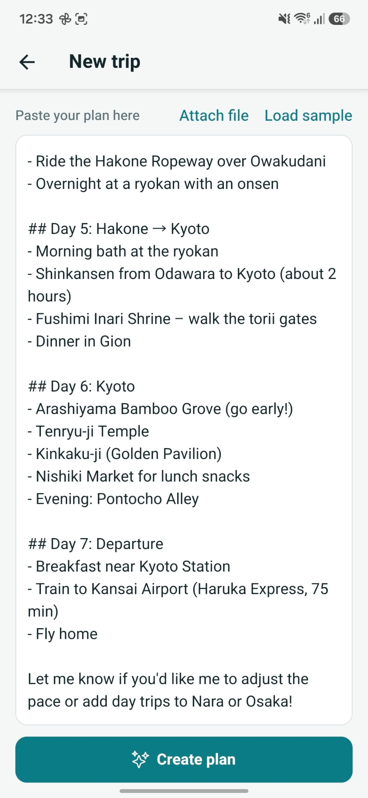
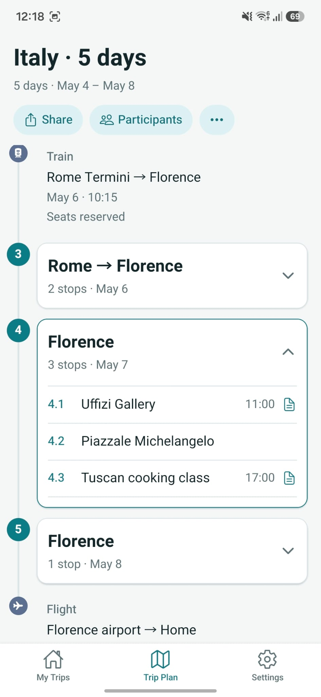
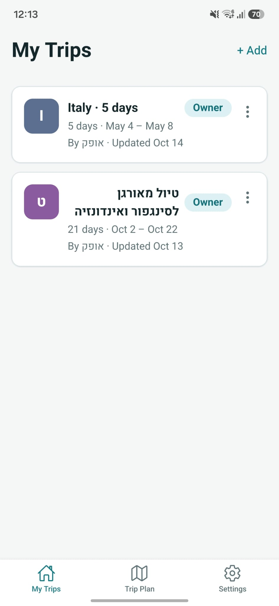
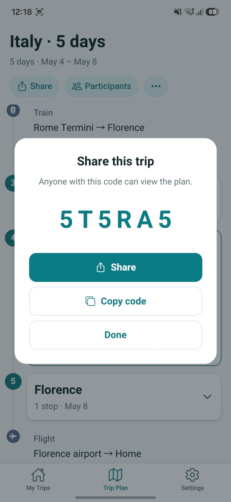
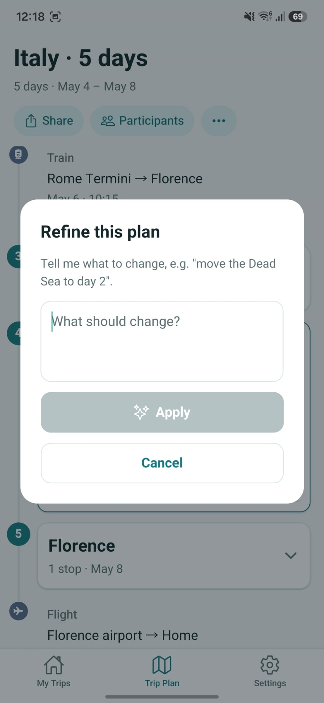
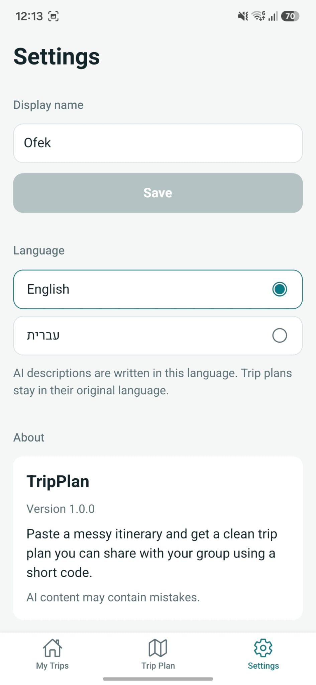

# TripPlan

A mobile app for sharing trip plans. Paste a messy itinerary (notes, a ChatGPT answer, a table, a PDF) and get a clean, structured timeline. Share it with the travel group using a 6-character code.

**The one idea it proves:** turn a messy itinerary into a clean, shareable plan, **with no invented details**.

Expo (React Native) + Supabase (Postgres, Edge Functions) + the Claude API. Built in three days as an MVP; **currently paused** ([roadmap](docs/ROADMAP.md)).

<p>
  
  
  
  
</p>

<details>
<summary>More screens</summary>
<p>
  
  
  
  
  
</p>
</details>

## What it does
- **Create:** paste text, attach a `.txt` or `.pdf`, or load a sample. The AI extracts days, activities, transit, arrival and departure. Times and dates appear only if the source states them.
- **Timeline:** arrival, numbered days (one open at a time), transit and departure nodes. Today's day is highlighted and opened automatically.
- **Activity details:** notes from the source, *Open in Maps*, and an on-demand *More info* summary (AI-generated, labeled, cached).
- **Share and join:** a code, the system share sheet, copy to clipboard. Joiners get a read-only view; pasting the whole share message works too.
- **Refine (owner only):** "move the Dead Sea to day 2". Undo and Redo switch between the last two versions without another AI call.
- **Languages:** English or Hebrew UI. Trip content in any language (including mixed Hebrew and English) renders in its own direction and is never translated.
- **Trust:** *View original text* shows exactly what was pasted.
- **Offline:** every trip is cached on the device; the app refetches on start and when it returns to the foreground.

## Architecture
```
Expo app (React Native, Expo Router, Zustand) ──► Supabase Edge Functions (Deno) ──► Claude API
                                                        │
                                                        └──► Postgres (service role only)
```
- All data access goes through four Edge Functions: `create-trip`, `get-trip`, `refine-trip`, `place-info`. The database has RLS on with no policies, so only the functions can read or write.
- The Anthropic key lives only in Supabase secrets. The app ships only a publishable key.
- The plan is one JSON document (`trips.plan`), defined by a Zod schema ([`plan-schema.ts`](supabase/functions/_shared/plan-schema.ts)). Model output is schema-constrained, then checked again on the server (days found, consecutive numbering, ids assigned), with one retry inside a fixed time budget.
- Models: Claude Sonnet for extraction and refinement, Claude Haiku for place summaries (cached per place and language).
- No accounts: the creator gets an owner token (kept in SecureStore; only its hash is on the server). Anyone with the share code can view; only the token holder can change.
- A compile-time contract test keeps the server's trip shape and the app's types in sync.

## Extraction quality
Seven samples in [`docs/samples/`](docs/samples/): long Hebrew tour text from a PDF, Hebrew, ChatGPT-style markdown, a table, messy notes, mixed Hebrew/English, and a plan with no times. Expected and actual results: [`docs/samples/README.md`](docs/samples/README.md). Latency is 5-15 seconds for a typical plan (about 25 seconds for a 21-day one). No invented names, times or dates were seen. [`scripts/eval-samples.mjs`](scripts/eval-samples.mjs) repeats the run with automatic checks.

## Run it
Full guide, including your own Supabase project and an Android APK build: [`docs/SETUP.md`](docs/SETUP.md).

```bash
# backend (Supabase CLI login and a project)
npx supabase link --project-ref <ref>
npx supabase db push
npx supabase secrets set ANTHROPIC_API_KEY=...
npx supabase functions deploy --use-api

# app
cd mobile
cp .env.example .env            # EXPO_PUBLIC_SUPABASE_URL and EXPO_PUBLIC_SUPABASE_ANON_KEY
npm install
npx expo start                  # scan the QR code with Expo Go on a phone
```

## Checks
```bash
cd mobile && npx tsc --noEmit && npx expo lint && npm test     # app: types, lint, unit tests
deno check supabase/functions/*/index.ts                        # functions: types
deno test supabase/functions/_tests/                            # functions: unit tests + app/server contract
node scripts/smoke-test.mjs                                     # all endpoints end to end, after each deploy
node scripts/eval-samples.mjs                                   # extraction check against the deployed function
```
GitHub Actions runs the first three on every push.

## Trade-offs
| Choice | Why | When it would change |
| --- | --- | --- |
| No accounts, owner token + share code | Fastest path to sharing; nothing to sign up for | Real users: accounts, invites, revoke |
| Refetch on start/foreground instead of realtime | Simple, works offline with a cached copy | Live collaboration: Supabase Realtime + push |
| One JSON `plan` column | The plan is read and written as a whole | Querying across trips: normalized tables |
| One level of Undo/Redo | Enough to compare two versions | Full history |
| Extraction only, nulls instead of guesses | Trust: nothing appears that the source did not say | Optional "suggest" mode, clearly separated |
| Typed dictionaries instead of an i18n library | Two languages; a missing translation is a type error | Plurals and formatting rules for many languages |
| `verify_jwt` off on the functions | The app uses a publishable key, which is not a JWT | Per-user auth with accounts |

## Documentation
| | |
| --- | --- |
| [`docs/DESIGN.md`](docs/DESIGN.md) | Product spec, architecture, database schema, API, AI design, decision log |
| [`docs/SETUP.md`](docs/SETUP.md) | Setting everything up from scratch, checks, operations |
| [`docs/ROADMAP.md`](docs/ROADMAP.md) | What is built, known limitations, next steps, how to pick it up again |
| [`docs/I18N.md`](docs/I18N.md) | UI languages: design, and the plan for a full RTL layout |
| [`docs/samples/`](docs/samples/) | Sample itineraries and extraction results |

## Repository
```
mobile/              Expo app (routes in src/app, components, i18n, lib, store, theme)
supabase/            migrations/ (schema) and functions/ (Edge Functions, shared code, tests)
scripts/             smoke test and sample eval against the deployed backend
docs/                design, setup, roadmap, samples
```

## License
[MIT](LICENSE)
